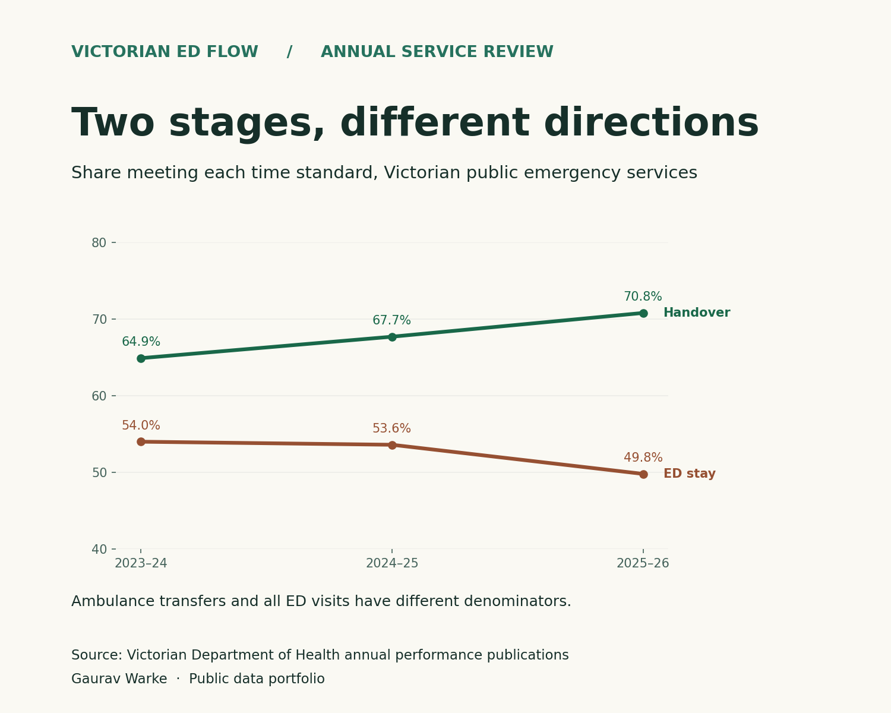

# Victorian ED Flow

**Where should an emergency department operations team investigate delays first?** In Victoria’s 2025–26 results, **49.8% of emergency department (ED) visits ended within four hours**, against a 75% target. That 25.2 percentage point gap was the largest of the four standards reviewed. Total time in the ED is the first measure this project recommends investigating locally.

## The business problem

Ambulance handover, the start of treatment and departure from the ED are different points in a patient’s journey. An improvement at one point can coincide with longer stays overall. An ED operations lead needs to know which measure warrants attention before asking clinical, ambulance or bed management teams to investigate.

## What the data shows

| Victorian emergency care standard, 2025–26 | Reported result | Target | Gap to target |
|---|---:|---:|---:|
| ED visit under four hours | 49.8% | 75% | 25.2 percentage points |
| Ambulance handover within 40 minutes | 70.8% | 90% | 19.2 percentage points |
| Treatment within the triage time standard | 70.3% | 80% | 9.7 percentage points |
| Category 1 patients treated immediately | 100% | 100% | Target met |

The three-year trend gives the first two rows context. From 2023–24 to 2025–26, the share of ambulance transfers completed within 40 minutes rose from **64.9% to 70.8%**. Over the same period, the share of ED visits under four hours fell from **54.0% to 49.8%**. The measures cover different patient groups. Their difference cannot be used to calculate how long patients waited after handover.

## What a hospital could do next

Separate visits that ended in admission from those that ended in discharge. For admitted patients, compare the time from arrival to first treatment with the time from the admission decision to departure. Review visit counts and missing timestamps by shift. A delay before treatment raises a different operational question from a delay while a patient waits for an inpatient bed.

This is a proposed investigation. The public figures do not identify a hospital, explain a delay or demonstrate an improvement in patient care.

## Technology

| Tool | Role in this project |
|---|---|
| R | [Independent analysis](analysis/review_flow.R) ranks target gaps, counts standards met and calculates changes across reporting years. |
| Python | [Validation](tests/check_register.py) checks the dashboard download against the source register and tests the headline figures. |
| HTML and CSS | Deliver the interactive dashboard as a single offline page. |

Run the analysis from the repository root with `Rscript analysis/review_flow.R` and `python tests/check_register.py`.

**Gaurav’s wider analytics toolkit:** SQL, Power BI, Excel and Tableau.

## Evidence and business analysis

The dashboard brings together eight published measure–year results from Victorian government performance reports. Each row in the source register links to its publication. Only handover and length of stay have three annual observations in this extract. The Python check compares the register with the dashboard download and recalculates the headline gaps.

- [Dashboard file](index.html) — four views covering service priorities, ambulance handover, length of stay and evidence.
- [Source register](data/annual-results.csv) and [validation checks](tests/check_register.py).
- [Business analysis report](docs/Business_Analysis.docx) and [working documents](docs/ba/) — business case, stakeholder roles, requirements and acceptance criteria.

**Author:** Gaurav Warke. Educational portfolio project. Not clinical advice. Source publications retain their original terms. A licence for the original project files has yet to be selected.
